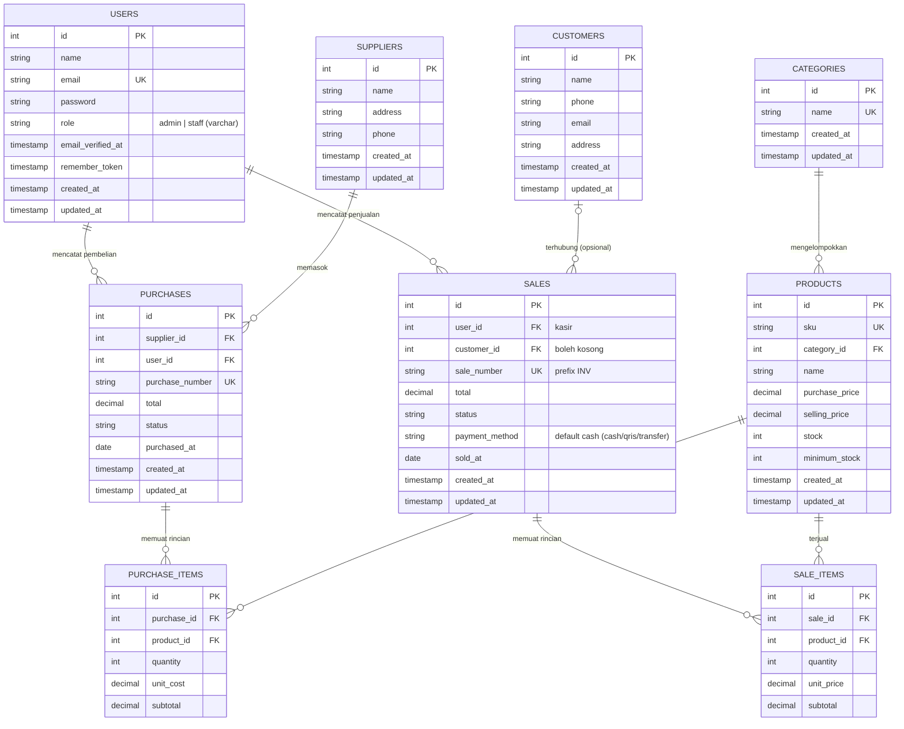

# 📐 ERD — Sweet Glaze

Entity Relationship Diagram database toko donat & minuman **Sweet Glaze**
(SQLite: `database/database.sqlite`), sesuai file migration di
`database/migrations/`.

## Penjelasan Relasi

| Relasi | Kardinalitas | Keterangan |
|---|---|---|
| `categories` → `products` | 1 : N (nullable) | Setiap donat/minuman opsional punya satu kategori menu (`products.category_id`). |
| `users` → `sales` | 1 : N | Admin/staff yang melayani transaksi kasir (`sales.user_id`). |
| `customers` → `sales` | 0..1 : N | Pelanggan opsional; checkout halaman katalog boleh tanpa akun pelanggan (`sales.customer_id` nullable). |
| `sales` → `sale_items` | 1 : N | Satu struk pembelian berisi banyak baris menu (`sale_items.sale_id`). |
| `products` → `sale_items` | 1 : N | Item struk mengunci harga jual saat transaksi (`unit_price`). |
| `users` → `purchases` | 1 : N | Admin/staff mencatat pembelian stok (`purchases.user_id`). |
| `suppliers` → `purchases` | 1 : N | Bahan/menu dibeli dari supplier tertentu (`purchases.supplier_id`). |
| `purchases` → `purchase_items` | 1 : N | Rincian barang pembelian (`purchase_items.purchase_id`). |
| `products` → `purchase_items` | 1 : N | Item pembelian merujuk produk (`purchase_items.product_id`, `unit_cost`). |

## Catatan Skema

- **Tabel `sales` punya kolom `payment_method`** (migration `2026_10_25_000001_add_payment_method_to_sales_table.php`, default `cash`) — menandai transaksi tunai pelanggan. Ini pembeda dari skema versi lain.
- Role `users.role` bertipe varchar dengan nilai **admin / staff**; pembeli tidak memiliki akun pengguna (data disimpan di tabel `customers`).
- **Alur stok**: stok berkurang lewat `App\Services\SaleService` saat order tersimpan (validasi anti-oversell), dan bertambah lewat `App\Services\PurchaseService` saat pembelian selesai.
- Nomor struk unik `sales.sale_number` dengan prefix `INV` (`INV-YYYYMMDD-XXXXX`), dibuat otomatis oleh service.
- Tabel `purchases` & `purchase_items` tersedia untuk modul pembelian stok; data harga memakai `decimal(12,2)` dalam Rupiah.
- Kolom harga `unit_price` pada `sale_items` disalin dari `selling_price` produk agar riwayat struk tidak berubah ketika harga menu diperbarui.
